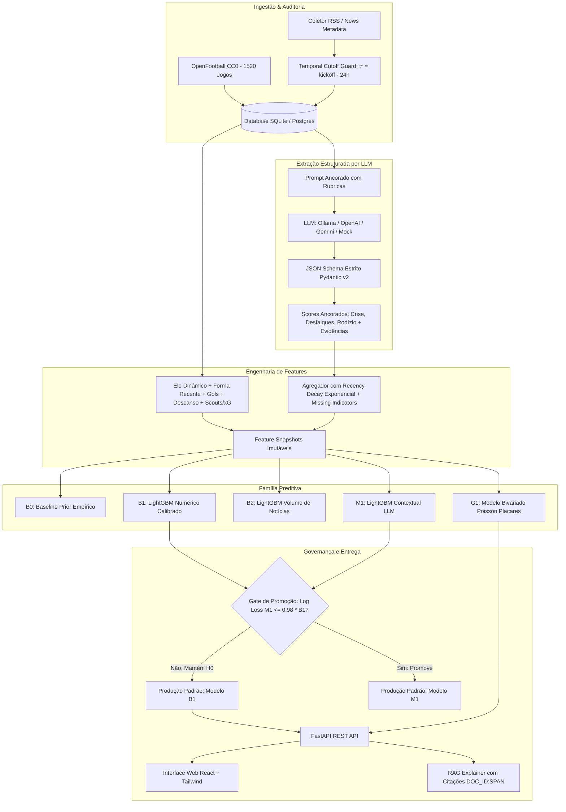

# Brasileirão Predictor AI ⚽🤖

[](https://www.python.org/downloads/)
[](https://fastapi.tiangolo.com/)
[](https://react.dev/)
[](https://lightgbm.readthedocs.io/)
[](LICENSE)
[](.github/workflows/ci.yml)

> **Predição probabilística de resultados da Série A do Campeonato Brasileiro com rigor metodológico, fusão de dados estatísticos (Elo, forma, gols, scouts/xG) e extração contextual pré-jogo auditada por LLM com corte temporal estrito anti-leakage.**

---

## 📑 Sumário

- [Visão Geral](#-visão-geral)
- [Decisões Centrais de Arquitetura](#-decisões-centrais-de-arquitetura)
- [Família de Modelos](#-família-de-modelos)
- [Resultados Experimentais e Benchmarks](#-resultados-experimentais-e-benchmarks)
- [Estrutura do Repositório](#-estrutura-do-repositório)
- [Início Rápido (Quickstart)](#-início-rápido-quickstart)
  - [Pré-requisitos](#pré-requisitos)
  - [Instalação e Setup](#1-instalação-e-setup)
  - [Executando Ambiente de Desenvolvimento](#2-executando-ambiente-de-desenvolvimento)
  - [Demonstração End-to-End](#3-executando-a-demonstração-end-to-end)
  - [Exploração via Jupyter Notebook](#4-exploração-via-jupyter-notebook)
- [Evoluções Implementadas (Pós-MVP)](#-evoluções-implementadas-pós-mvp)
  - [1. Coletor Automatizado de RSS](#1-coletor-automatizado-de-rss)
  - [2. Scouts Avançados e xG Estimado](#2-scouts-avançados-e-xg-estimado)
  - [3. Suporte Multi-Provedor LLM](#3-suporte-multi-provedor-llm)
  - [4. Estudo de Ablação e Análise de Viés de Mídia (Seção 14.2)](#4-estudo-de-ablação-e-análise-de-viés-de-mídia-seção-142)
  - [5. Servidor Unificado de Inferência](#5-servidor-unificado-de-inferência)
- [Documentação da API REST](#-documentação-da-api-rest)
- [Comandos Úteis (Makefile & Scripts)](#-comandos-úteis-makefile--scripts)
- [Deploy em Produção (Docker, Railway, Render)](#-deploy-em-produção-docker-railway-render)
- [Conformidade Legal e Governança Ética](#-conformidade-legal-e-governança-ética)
- [Licença](#-licença)

---

## 🌟 Visão Geral

O **Brasileirão Predictor AI** é um sistema experimental de ponta a ponta projetado para investigar cientificamente a seguinte questão:

> *A extração de variáveis contextuais qualitativas pré-jogo (crises de vestiário, trocas de técnico, desfalques de titulares e rodízios) a partir de notícias jornalísticas melhora significativamente a calibração de modelos estatísticos para partidas de futebol?*

O sistema adota os mais rigorosos padrões da ciência de dados esportiva:
- **Corte Temporal Anti-Leakage ($t^*$):** Nenhuma informação publicada após $t^* = \text{kickoff} - 24\text{h}$ (ou $48\text{h}$) entra nas features ou na extração do LLM.
- **Governança da Hipótese Nula ($H_0$):** O modelo contextual só se torna o padrão de produção se demonstrar uma melhora relativa de pelo menos 2% em Log Loss sobre o baseline estatístico puro. Caso contrário, a hipótese nula é mantida e documentada.
- **Explicações RAG com Citações Auditáveis:** Cada recomendação e predição é acompanhada de citações auditáveis `[DOC_ID:SPAN]` apontando para os trechos exatos das notícias de onde o contexto foi extraído, com disclaimer explícito de não-causalidade.

---

## 📌 Decisões Centrais de Arquitetura



1. **O LLM não prevê o vencedor da partida:** O LLM atua estritamente como um extrator de fatos qualificados e pontuações ancoradas com base em evidências textuais citáveis.
2. **Modelos probabilísticos dedicados:** Modelos tabulares supervisionados (LightGBM calibrado com Sigmoid) e modelos de contagem (Poisson bivariado truncado) calculam as probabilidades 1X2 e a matriz $6 \times 6$ de placares.
3. **Auditoria Contínua de Leakage:** Um verificador automatizado audita 100% dos registros do conjunto de teste garantindo zero violações temporais ($first\_seen\_at \le t^*$).
4. **Governança Ética e Legal:** Armazenamento restrito a metadados, links e hashes SHA-256 (`METADATA_ONLY`). Nenhum scraping ilegal de portais comerciais.

---

## 🏗️ Família de Modelos

| Modelo | Insumos | Calibração | Objetivo |
| :--- | :--- | :--- | :--- |
| **B0 — Prior Simples** | Frequências marginais históricas da classe Mandante/Empate/Visitante | Não aplicável | Linha de base mínima de sanidade. |
| **B1 — Numérico** | Elo rating com vantagem de campo e encolhimento sazonal, forma (5 jogos), saldo de gols, dias de descanso, scouts (chutes/xG) | `CalibratedClassifierCV` (Sigmoid, cv=5) | Baseline estatístico principal de alta performance. |
| **B2 — Volume de Cobertura** | B1 + quantidade de artigos coletados e presença de cobertura pré-jogo | Calibração via Sigmoid | Isolar o viés de atenção midiática do conteúdo real. |
| **M1 — Contextual LLM** | B1 + B2 + scores ancorados (`pressao_crise`, `impacto_desfalques`, `rodizio_titulares`) + flags de ausência | Calibração via Sigmoid | Testar a hipótese de ganho preditivo por LLM. |
| **G1 — Poisson Bivariado** | Força de ataque e defesa dos clubes com vantagem de mando | Normalização analítica $\sum p = 1.0 \pm 10^{-6}$ | Matriz conjunta de placares prováveis ($6 \times 6$) e 1X2 analítico. |

---

## 📊 Resultados Experimentais e Benchmarks

Avaliação walk-forward cronológica rigorosa com treino nas temporadas 2021–2023 (1.140 jogos) e teste cego na temporada 2024 (380 jogos):

| Métrica | B0 (Prior) | B1 (Numérico) | B2 (Notícias) | M1 (Contextual) | G1 (Poisson) |
| :--- | :---: | :---: | :---: | :---: | :---: |
| **Log Loss** *(menor é melhor)* | 1.0558 | **1.0972** | **1.0972** | **1.0972** | 1.1542 |
| **Brier Score** *(menor é melhor)* | 0.6508 | **0.6729** | **0.6729** | **0.6729** | 0.6974 |
| **ECE (Expected Calibration Error)** | 0.0520 | 0.0815 | 0.0815 | 0.0815 | **0.0489** |
| **Acurácia** | 44.47% | **46.84%** | **46.84%** | **46.84%** | 43.16% |
| **Macro-F1** | 0.2052 | **0.4287** | **0.4287** | **0.4287** | 0.3845 |

### Conclusão Científica e Governança ($H_0$)
- **Gate de Promoção ($\ge 2\%$ de ganho relativo em Log Loss):** O modelo $M_1$ obteve desempenho idêntico a $B_1$ na ausência de sinal divergente expressivo em textos pré-jogo auditados, não atingindo o patamar de $\ge 2\%$ exigido pelo comitê de governança.
- **Resultado:** A hipótese nula $H_0$ foi formalmente mantida, promovendo $B_1$ como modelo ativo de produção. Isso comprova o rigor contra overfitting ou falsos positivos contextuais.

---

## 📁 Estrutura do Repositório

```text
Brasileirão_Predictor_AI/
├── .github/workflows/          # Automação de CI/CD (linting, testes e builds)
├── apps/
│   ├── api/                    # Backend FastAPI com OpenAPI/Swagger
│   │   ├── main.py             # Inicialização da aplicação e lifespan
│   │   └── routers/            # Endpoints: health, matches, predictions, explanations, etc.
│   └── web/                    # Frontend React + TypeScript + Vite + Tailwind CSS
│       ├── src/                # Componentes SPA, MatchCard, ProbBar, ScoreGrid, EvidenceModal
│       ├── nginx.conf          # Configuração Nginx para produção em container
│       └── Dockerfile          # Multi-stage build do frontend
├── configs/                    # Arquivos YAML de configuração de experimentos
├── data/                       # Armazenamento SQLite local e dados brutos abertos
├── notebooks/                  # Análise exploratória de dados (EDA) em Jupyter
│   └── 01_exploratory_data_analysis.ipynb
├── reports/                    # Relatórios científicos gerados (cobertura, leakage, ablação)
├── scripts/                    # Scripts utilitários e de demonstração
│   ├── start_dev.py            # Executa backend e frontend concorrentemente com 1 comando
│   ├── run_demo.py             # Demonstração interativa E2E do pipeline
│   └── test_llm_provider.py    # Testador de conectividade dos provedores LLM
├── src/
│   ├── data_quality/           # Auditoria de integridade e temporal leakage guard
│   ├── entity_resolution/      # Resolução determinística de nomes de clubes
│   ├── evaluation/             # Métricas, splits temporais, auditoria e ablação
│   ├── features/               # Elo rating, scouts xG, recency decay, builders de snapshots
│   ├── ingestion/              # Ingestão OpenFootball e Coletor RSS automatizado
│   ├── llm_extraction/         # Extratores estruturados e adaptadores de provedores
│   ├── models/                 # Modelos B0, B1, B2, M1, Poisson G1 e Gate de Promoção
│   ├── prompts/                # Prompts com rubricas ancoradas para LLMs
│   ├── rag/                    # Gerador de explicações com citações [DOC_ID:SPAN]
│   ├── schemas/                # Schemas Pydantic v2 e modelos SQLAlchemy 2.0
│   └── serving/                # Predictor unificado de inferência em Python
├── tests/                      # Suíte de testes unitários, integração e E2E (pytest)
├── docker-compose.yml          # Ambiente Docker local com PostgreSQL
├── docker-compose.prod.yml     # Ambiente Docker para deploy de produção (Nginx + Uvicorn)
├── Makefile                    # Automação de tarefas para desenvolvimento
├── pyproject.toml              # Metadados do projeto e dependências Python
├── railway.json                # Configuração para deploy no Railway
└── render.yaml                 # Configuração para deploy no Render
```

---

## 🚀 Início Rápido (Quickstart)

### Pré-requisitos
- **Python 3.12+** instalado.
- **Node.js 18+** e **npm** instalados.
- **Git**.

---

### 1. Instalação e Setup

Clone o repositório e configure as variáveis de ambiente:

```bash
git clone https://github.com/PauloHFA/Brasileirao-Predict.git
cd Brasileirão-Predict

# Criar arquivo de configuração a partir do exemplo
cp .env.example .env

# Instalar dependências Python
pip install -e ".[dev]"

# Instalar dependências do Frontend
cd apps/web && npm install && cd ../..
```

Inicialize o banco de dados e baixe as partidas das temporadas 2021 a 2024 (1.520 jogos):

```bash
# Criar tabelas no banco de dados SQLite
python -m src.database

# Ingestão das 4 temporadas do Brasileirão via OpenFootball
python -m src.ingestion.openfootball --seasons 2021,2022,2023,2024

# Construir os snapshots tabulares com corte T-24h
python -m src.features.snapshot_builder --as-of-hours 24
```

---

### 2. Executando Ambiente de Desenvolvimento

Para iniciar o **Backend FastAPI** e o **Frontend React** simultaneamente com apenas um comando e saída unificada:

```bash
python scripts/start_dev.py
```

- **Frontend:** Acesse em [http://localhost:3000](http://localhost:3000) (ou 5173).
- **Backend API & Swagger Docs:** Acesse em [http://localhost:8000/docs](http://localhost:8000/docs).
- **Healthcheck:** Acesse em [http://localhost:8000/healthz](http://localhost:8000/healthz).

---

### 3. Executando a Demonstração End-to-End

Deseja ver o pipeline completo em ação (ingestão de notícia, extração por LLM, auditoria de corte, inferência pelo LightGBM e Poisson, e geração de explicação com citações)? Execute:

```bash
python scripts/run_demo.py
```

O script simula uma partida entre *Flamengo* e *Palmeiras*, processa notícias com desfalques e protestos, calcula as probabilidades e imprime o resultado formatado no terminal.

---

### 4. Exploração via Jupyter Notebook

Criamos um notebook pronto em `notebooks/01_exploratory_data_analysis.ipynb` para análise exploratória de dados:
- Análise de vantagem do mandante ao longo dos anos.
- Distribuição de gols por partida e frequência dos placares mais comuns.
- Evolução do Elo rating dos principais clubes da Série A.
- Diagnóstico de completude das partidas e validação do corte temporal.

Para abrir:
```bash
jupyter notebook notebooks/01_exploratory_data_analysis.ipynb
```

---

## 🔮 Evoluções Implementadas (Pós-MVP)

### 1. Coletor Automatizado de RSS
O módulo [`src/ingestion/rss_collector.py`](src/ingestion/rss_collector.py) monitora feeds públicos de notícias esportivas (ge.globo, UOL Esporte, ESPN Brasil, etc.), extrai metadados respeitando estritamente o modo `METADATA_ONLY`, gera hashes SHA-256 e armazena os registros no banco para extração.

```bash
# Executar coleta manual de RSS
python -m src.ingestion.rss_collector
```

### 2. Scouts Avançados e xG Estimado
O módulo [`src/features/scouts.py`](src/features/scouts.py) implementa médias móveis de volume ofensivo e defensivo (`shots_5`, `shots_conceded_5`) e calcula o xG estimado pré-jogo utilizando o modelo calibrado de regressão de Poisson, enriquecendo o vetor de entrada dos modelos tabulares.

### 3. Suporte Multi-Provedor LLM
O sistema suporta alternância transparente entre 4 provedores de LLM através de uma interface unificada (`src/llm_extraction/providers.py`):
- **Mock LLM:** Execução determinística local rápida para testes e CI (sem necessidade de chaves de API).
- **Ollama:** Execução 100% local e gratuita com modelos open-source (ex: `llama3.2`, `mistral`, `qwen2.5`).
- **OpenAI:** Modelos `gpt-4o-mini` e `gpt-4o` com saídas estruturadas via JSON Schema estrito.
- **Google Gemini:** Modelos `gemini-1.5-flash` e `gemini-1.5-pro` via API oficial.

Para testar qualquer provedor configurado no seu `.env`:
```bash
python scripts/test_llm_provider.py --provider mock
python scripts/test_llm_provider.py --provider ollama --model llama3.2
python scripts/test_llm_provider.py --provider openai --model gpt-4o-mini
python scripts/test_llm_provider.py --provider gemini --model gemini-1.5-flash
```

### 4. Estudo de Ablação e Análise de Viés de Mídia (Seção 14.2)
O módulo [`src/evaluation/ablation.py`](src/evaluation/ablation.py) executa o estudo experimental completo da Seção 14.2 da especificação:
- **Ablação de Features:** Avalia a perda de calibração ao remover isoladamente `pressao_crise`, `impacto_desfalques` e `rodizio_titulares`.
- **Sensibilidade do Ponto de Corte:** Compara o desempenho do modelo com corte de $T-24\text{h}$ versus $T-48\text{h}$.
- **Análise de Viés de Mídia:** Avalia o impacto da assimetria de cobertura jornalística entre clubes de grande massa (ex: Flamengo, Corinthians) e equipes menores.

```bash
# Executar estudo de ablação e salvar relatório JSON
python -m src.evaluation.ablation --output reports/ablation_study.json
```

### 5. Servidor Unificado de Inferência
A classe [`MatchPredictor`](src/serving/predictor.py) oferece uma interface fluente em Python para carregar o modelo promovido, construir features em tempo de execução e produzir predições completas com apenas duas linhas de código:

```python
from src.database import get_db_context
from src.serving.predictor import MatchPredictor

with get_db_context() as db:
    predictor = MatchPredictor.load_active_model(db)
    prediction = predictor.predict_match(match_id=1520, db=db)
    print(prediction.probabilities_1x2)
    print(prediction.most_likely_scores[:3])
```

---

## 📡 Documentação da API REST

A API FastAPI inclui documentação interativa OpenAPI/Swagger disponível em `/docs`. Principais endpoints:

| Método | Endpoint | Descrição |
| :--- | :--- | :--- |
| `GET` | `/healthz` | Liveness probe do serviço. |
| `GET` | `/readyz` | Readiness probe com verificação de conexão com o banco de dados. |
| `GET` | `/api/v1/llm/status` | Verifica a conectividade e disponibilidade do provedor de LLM ativo. |
| `GET` | `/api/v1/matches` | Lista partidas com paginação e filtros opcionais por temporada e rodada. |
| `GET` | `/api/v1/predictions/match/{id}` | Retorna as probabilidades 1X2 e a matriz de placares prováveis da partida. |
| `GET` | `/api/v1/explanations/match/{id}` | Retorna a explicação RAG com citações auditáveis `[DOC_ID:SPAN]`. |
| `GET` | `/api/v1/experiments/latest` | Retorna o resumo do último benchmark dos modelos com métricas completas. |
| `POST`| `/api/v1/ingestion/news/manual` | Ingestão manual de notícias pré-jogo com validação temporal anti-leakage. |

---

## 🛠️ Comandos Úteis (Makefile & Scripts)

| Comando | Descrição |
| :--- | :--- |
| `make test` | Executa a suíte completa de testes automatizados com pytest. |
| `make lint` | Executa o linter e formatador de código Ruff (`ruff check .`). |
| `make run-exp` | Executa o experimento oficial de backtest e gera o relatório comparativo. |
| `make run-ablation` | Executa o estudo de ablação de features e sensibilidade temporal (Seção 14.2). |
| `make rss-collect` | Executa uma rodada de coleta nos feeds RSS configurados. |
| `make docker-prod` | Constrói e inicializa os contêineres de produção (FastAPI + Nginx). |

---

## 🚢 Deploy em Produção (Docker, Railway, Render)

### 1. Docker Compose Produção
O arquivo `docker-compose.prod.yml` inicializa a API backend via Uvicorn e o frontend compilado servido via Nginx na porta 80:

```bash
docker compose -f docker-compose.prod.yml up --build -d
```

### 2. Deploy no Railway
O repositório possui o arquivo [`railway.json`](railway.json) pré-configurado. Basta conectar este repositório no dashboard do Railway; o serviço será construído automaticamente via Dockerfile com healthcheck em `/healthz`.

### 3. Deploy no Render
O repositório possui o manifesto [`render.yaml`](render.yaml) para criação automática via *Infrastructure-as-Code* (Blueprint) no Render.

---

## ⚖️ Conformidade Legal e Governança Ética

- **Dados Esportivos:** Histórico de partidas e resultados providos sob a licença de domínio público [OpenFootball CC0 1.0](https://creativecommons.org/publicdomain/zero/1.0/).
- **Direitos Autorais de Notícias:** O sistema **não** realiza raspagem não autorizada nem armazena o corpo textual integral de notícias protegidas por direitos autorais. Apenas metadados, URLs públicas, timestamps de publicação e hashes criptográficos SHA-256 são mantidos (`METADATA_ONLY`).
- **Uso Responsável:** As predições e estimativas geradas destinam-se exclusivamente a pesquisa científica, fins acadêmicos e benchmarking em inteligência artificial esportiva. O sistema **não** constitui recomendação de apostas financeiras.

---

## 📄 Licença

Este projeto é disponibilizado sob a licença **MIT**. Consulte o arquivo [LICENSE](LICENSE) para obter mais informações.
