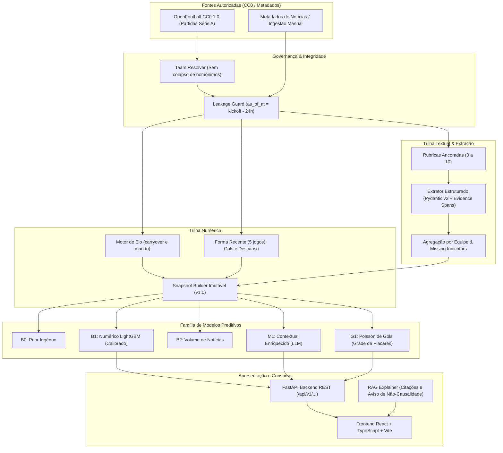

# Arquitetura do Brasileirão Predictor AI

Este documento detalha as decisões técnicas, modelo de dados, pipeline de features, modelagem estatística, extração via LLM e infraestrutura do **Brasileirão Predictor AI**.

---

## 1. Visão Geral e Princípios Arquiteturais

1. **Separação Rígida entre Contexto e Previsão:**
   O Modelo de Linguagem (LLM) atua estritamente como um extrator estruturado de fatos objetivos (lesões confirmadas, crises/protestos, rodízios de titulares) sob um JSON Schema rígido (Pydantic v2). O LLM **nunca** calcula nem estima probabilidades de resultado esportivo diretamente.
2. **Prevenção Estrita de Data Leakage:**
   A unidade atômica de previsão opera em $t^* = \text{kickoff} - 24\text{h}$ (ou $48\text{h}$). Nenhuma estatística posterior, placar da partida-alvo ou notícia publicada/observada após $t^*$ pode entrar no snapshot de features.
3. **Governança da Hipótese Nula ($H_0$):**
   O modelo contextual ($M_1$) só é promovido à produção se demonstrar uma redução relativa mínima de 2% em Log Loss sobre o baseline numérico ($B_1$) com suporte por intervalo de confiança bootstrap 95% e sem degradação de calibração (ECE).

---

## 2. Diagrama de Linhagem e Componentes

---

## 3. Modelo Conceitual de Dados

| Entidade | Chave Primária | Principais Campos | Função |
| :--- | :--- | :--- | :--- |
| `teams` | `team_id` | `canonical_name`, `slug`, `aliases` (JSON) | Cadastro canônico de clubes |
| `matches` | `match_id` | `season`, `round`, `kickoff_at`, `home_team_id`, `away_team_id`, `goals_home`, `goals_away`, `status` | Fatos de jogos finalizados |
| `match_sources` | `source_id` | `source_name`, `version`, `sha256`, `fetched_at` | Rastreabilidade e proveniência CC0 |
| `articles` | `article_id` | `canonical_url`, `published_at`, `first_seen_at`, `source_name`, `rights_status`, `content_sha256` | Metadados de reportagens |
| `article_entities` | `id` | `article_id`, `team_id`, `match_id`, `relevance` | Vinculação artigo-clube-jogo |
| `llm_extractions` | `extraction_id` | `article_id`, `model_id`, `prompt_version`, `schema_version`, `extracted_json`, `status` | Extrações estruturadas persistidas |
| `feature_snapshots` | `snapshot_id` | `match_id`, `as_of_at`, `feature_version`, `features` (JSON), `snapshot_hash` | Foto congelada pre-match |
| `predictions` | `prediction_id` | `match_id`, `snapshot_id`, `model_id`, `p_home`, `p_draw`, `p_away`, `score_distribution` | Previsões rastreáveis |
| `evidence_links` | `id` | `prediction_id`, `article_id`, `extraction_id`, `fact_key` | Ligações previsão-fato citado |
| `model_runs` | `run_id` | `config_hash`, `split_id`, `model_type`, `metrics` (JSON), `artifact_uri` | Reprodutibilidade de experimentos |

---

## 4. Contratos de API REST

- `GET /healthz`: Verificação de vivacidade do processo.
- `GET /readyz`: Verificação de conectividade com banco de dados.
- `GET /api/v1/seasons`: Listagem de temporadas auditadas e cobertura de partidas.
- `GET /api/v1/matches`: Listagem filtrada por temporada, rodada e status.
- `GET /api/v1/matches/{id}/features`: Consulta de snapshot tabular congelado pre-match.
- `POST /api/v1/predictions`: Simulação de probabilidade 1X2 e matriz de placares (Poisson).
- `GET /api/v1/predictions/{id}`: Consulta de previsão persistida.
- `GET /api/v1/matches/{id}/evidence`: Evidências jornalísticas auditadas antes do corte.
- `POST /api/v1/explanations`: Geração de explicação contextual com citações de IDs de evidência.
- `GET /api/v1/experiments`: Consulta aos resultados experimentais e status do gate de promoção.
- `POST /api/v1/ingestion/manual`: Ingestão manual auditada de notícias pré-jogo com validação temporal.
